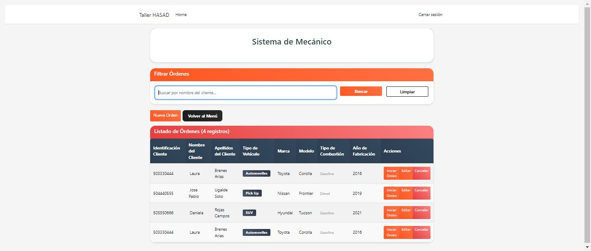
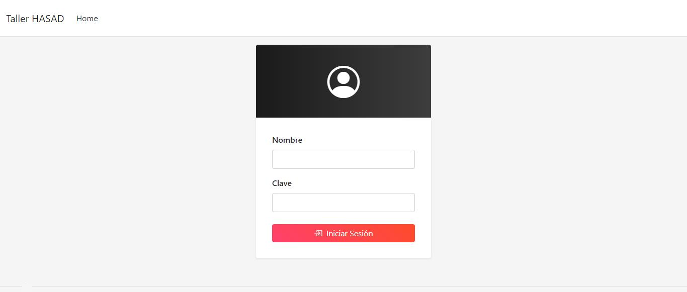
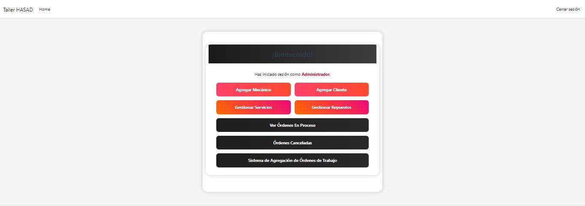
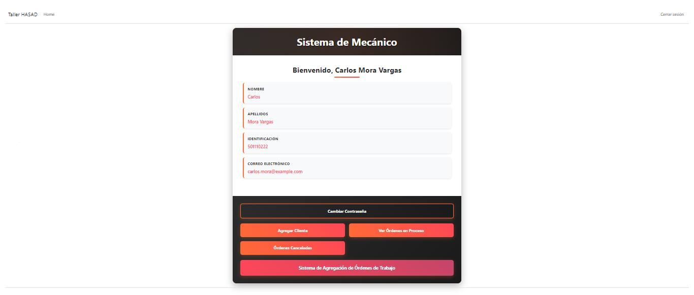
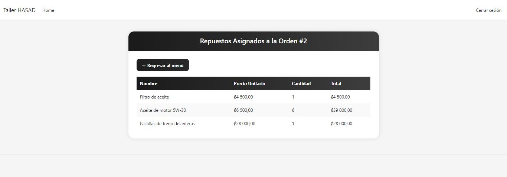
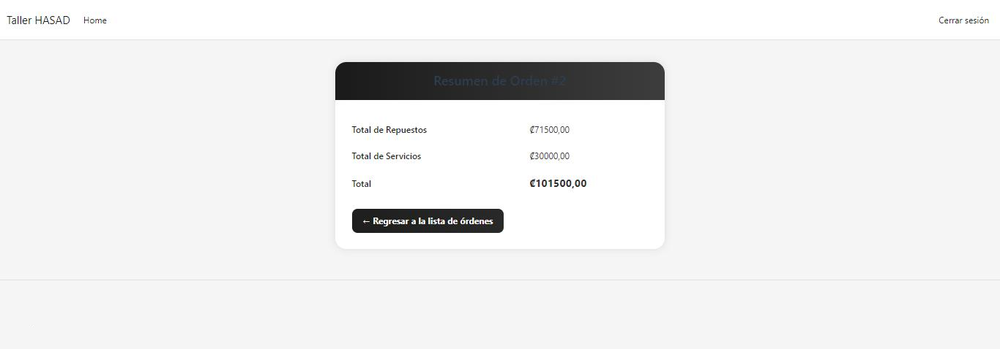
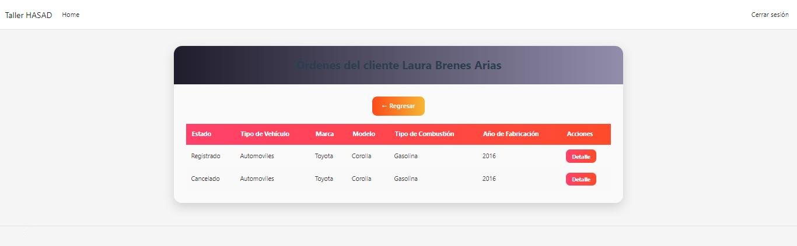
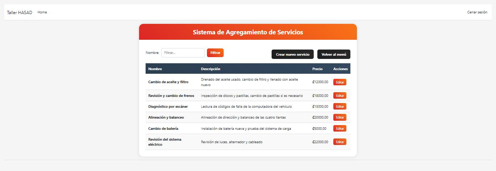

# Sistema de Órdenes de Reparación

*[Read in English](README.md)*

Aplicación web para administrar un taller mecánico: clientes, mecánicos, inventario de repuestos y servicios, y el ciclo completo de una orden de trabajo, desde que se registra el vehículo hasta el resumen de costos que ve el cliente.

Proyecto del curso **IF4101 Lenguajes para Aplicaciones Comerciales**, Universidad de Costa Rica, Sede Guanacaste (I ciclo 2025). Lo desarrollamos en equipo y estuvo publicado en Azure App Service con base de datos en Azure SQL.



## Funcionalidades

- **Tres roles con vistas propias:** administrador, mecánico y cliente.
- **Inicio de sesión:** contraseñas con hash BCrypt, bloqueo temporal de la cuenta tras varios intentos fallidos, aviso por correo de cada inicio de sesión y cambio de contraseña.
- **Clientes y mecánicos:** registro, edición y búsqueda por nombre. Al registrar un usuario se generan sus credenciales y se le envían por correo.
- **Catálogos:** inventario de repuestos y de servicios con alta, edición, detalle y filtro por nombre.
- **Órdenes de trabajo:** crear, editar, iniciar y cancelar (con motivo). Se registran el tipo de vehículo, el tipo de combustión, la marca, el modelo y el año.
- **Trabajo del mecánico:** asignar repuestos y servicios a una orden en proceso, ver lo asignado, consultar el resumen de costos y revisar las órdenes canceladas.
- **Vista del cliente:** el estado de sus órdenes, los repuestos y servicios aplicados y el resumen de costos.

## Capturas

| | |
|---|---|
|  |  |
| Inicio de sesión | Panel del administrador |
|  |  |
| Panel del mecánico | Repuestos asignados a una orden en proceso |
|  |  |
| Resumen de costos de la orden | Órdenes vistas por el cliente |
|  | |
| Catálogo de servicios (mi módulo) | |

## Arquitectura

```
┌────────────────────┐   HTTP + X-API-KEY   ┌────────────────────┐
│  UI (ASP.NET MVC)  │ ───────────────────▶ │  SI (Web API REST) │
│  Razor + Bootstrap │                      │  Swagger           │
└────────────────────┘                      └─────────┬──────────┘
                                                      │
                                            ┌─────────▼──────────┐
                                            │  BL (lógica de     │
                                            │  negocio)          │
                                            └─────────┬──────────┘
                                                      │
                                            ┌─────────▼──────────┐      ┌──────────────┐
                                            │  DA (EF Core       │ ───▶ │  SQL Server  │
                                            │  DbContext)        │      │  / Azure SQL │
                                            └────────────────────┘      └──────────────┘
                 Model: entidades, DTOs y ViewModels compartidos
```

| Proyecto | Responsabilidad |
|---|---|
| `SistemaDeOrdenesDeReparacion.Model` | Entidades, enumeraciones, DTOs y ViewModels |
| `SistemaDeOrdenesDeReparacion.DA` | Acceso a datos con Entity Framework Core |
| `SistemaDeOrdenesDeReparacion.BL` | Reglas de negocio, validaciones y envío de correos |
| `SistemaDeOrdenesDeReparacion.SI` | API REST (servicios de integración) protegida con API key |
| `SistemaDeOrdenesDeReparacion.UI` | Aplicación MVC que consume la API y maneja la sesión del usuario |

La primera versión del sistema accedía a la lógica de negocio directamente desde MVC. En la segunda fase migramos cada módulo para que la interfaz consuma la API REST.

## Tecnologías

C# · .NET 8 · ASP.NET Core MVC · ASP.NET Core Web API · Entity Framework Core 8 · SQL Server / Azure SQL · Swagger · Bootstrap 5 · jQuery Validation · Azure App Service · Git (GitLab UCR)

## Cómo ejecutarlo

**Requisitos:** .NET 8 SDK y SQL Server (sirve LocalDB o SQL Server Express).

1. Copie las plantillas de configuración y complete sus valores:
   - `SistemaDeOrdenesDeReparacion.SI/appsettings.Development.example.json` → `appsettings.Development.json`
   - `SistemaDeOrdenesDeReparacion.UI/appsettings.UI.Development.example.json` → `appsettings.UI.Development.json`

   La `ApiKey` tiene que ser la misma en los dos proyectos. Para el correo use una cuenta de Gmail con [contraseña de aplicación](https://support.google.com/accounts/answer/185833). Estos archivos están en `.gitignore`, así que nunca se suben al repositorio.
2. Cree la base de datos con los scripts de la carpeta `database/`, en SSMS o con `sqlcmd`:
   ```bash
   sqlcmd -S localhost -E -f 65001 -i database/schema.sql
   sqlcmd -S localhost -E -f 65001 -i database/seed.sql
   ```
   El primero crea la base `SistemaDeOrdenesDeReparacion` con todas las tablas. El segundo carga datos de ejemplo inventados: clientes, mecánicos, repuestos, servicios y órdenes en distintos estados. En `appsettings.Development.json` use `Database=SistemaDeOrdenesDeReparacion`.
3. Ejecute los dos proyectos (en Visual Studio: *Configurar proyectos de inicio → Varios*, con SI y UI):
   ```bash
   dotnet run --project SistemaDeOrdenesDeReparacion.SI --launch-profile https
   dotnet run --project SistemaDeOrdenesDeReparacion.UI --launch-profile https
   ```
   La API queda en `https://localhost:7102` (Swagger en `/swagger`) y la interfaz en `https://localhost:7214`.

### Usuarios de prueba

| Rol | Usuario | Contraseña |
|---|---|---|
| Administrador | `admin` | `Admin2025!` |
| Mecánico | `CarlosMoraVargas` | `Demo2025!` |
| Cliente | `LauraBrenesArias` | `Demo2025!` |

## Equipo

Proyecto grupal de cinco estudiantes:

- Aarón Salazar Mata
- Sebastián Apu Guillén
- Harold Barquero
- Daniel Solís
- **Deiby Ruiz Rodríguez**

### Mi aporte

- **Módulo de trabajo del mecánico** (creé `TrabajoMecanicoController` y sus 15 vistas; luego el equipo lo integró con la API): asignación de repuestos y servicios a órdenes en proceso, consulta de lo asignado, resumen de costos para el mecánico y el cliente, y listado y detalle de órdenes canceladas. También agregué las entidades intermedias orden–repuesto y orden–servicio y la lógica correspondiente en `GestionDeOrdenesDeTrabajo`.
- **Catálogo de servicios** de punta a punta: modelo `InventarioDeServicios`, `CatalogoDeServicios` en la BL, `ServiciosController` y vistas de listado, filtro, creación, edición y detalle.
- **Migración a la API REST** de los módulos de repuestos y servicios: creé `ServicioDeRepuestosController` y `ServicioDeServiciosController` en la Web API y adapté los controladores MVC para consumirlos con `HttpClient` y API key.
- Mejoras visuales en la vista del administrador y en el panel del mecánico y del cliente.

## Notas de esta versión

Esta copia para portafolio parte del repositorio original del curso. Respecto a él:

- Las credenciales (cadena de conexión, API key y cuenta SMTP) salieron del código y de los `appsettings` y ahora se leen desde la configuración. El envío de correos quedó centralizado en `ServicioDeCorreo`.
- La UI carga su configuración antes de construir la aplicación e incluye `appsettings.UI.{Ambiente}.json`.
- Se quitaron los perfiles de publicación de Azure.
- Las contraseñas se guardan con hash **BCrypt** (`SeguridadDeContrasenas`). Las contraseñas antiguas en texto plano se migran a hash automáticamente la próxima vez que el usuario inicia sesión.
- Si falla el envío de un correo de notificación (inicio de sesión, bloqueo, cambio de clave), el error se registra y el inicio de sesión continúa.
- Se agregaron los scripts `database/schema.sql` y `database/seed.sql` para crear la base de datos con datos de ejemplo.

**Mejoras pendientes:** agregar migraciones de EF Core y pruebas unitarias.
