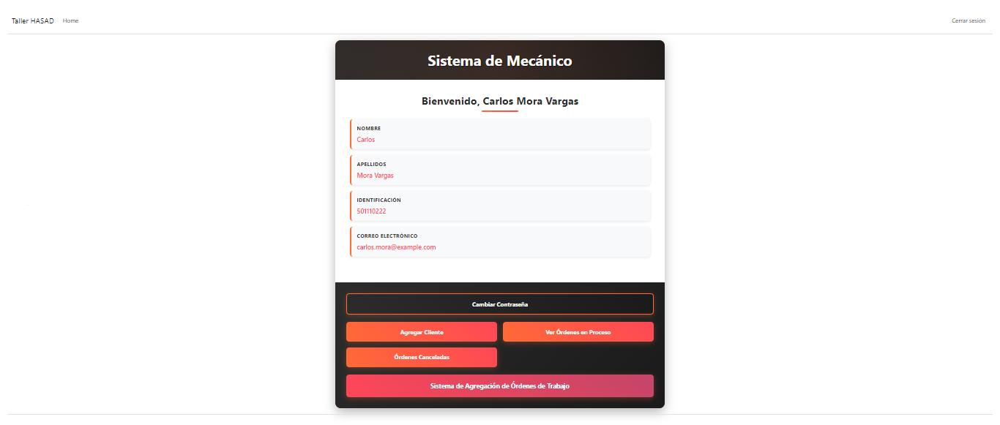
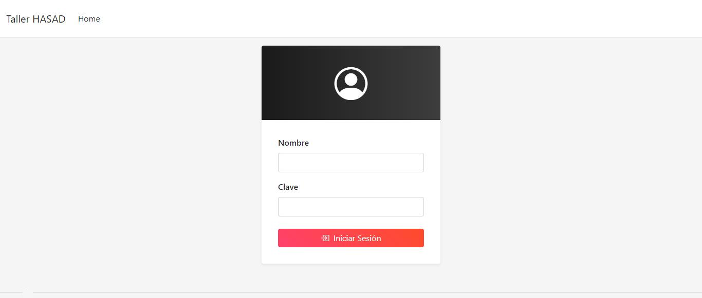
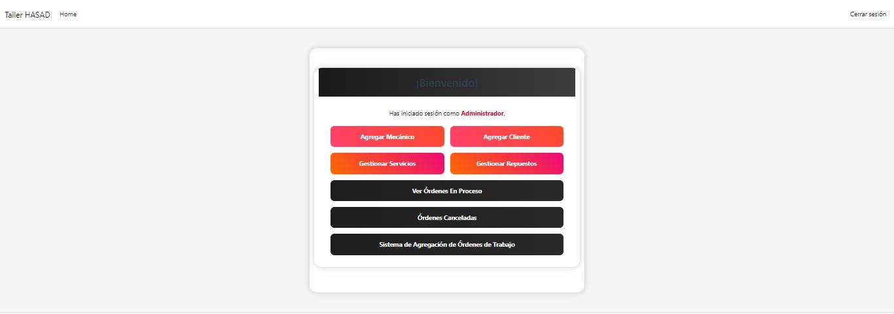
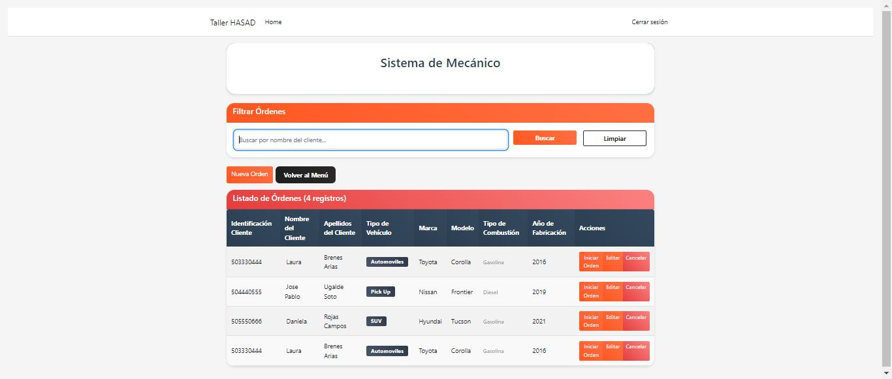
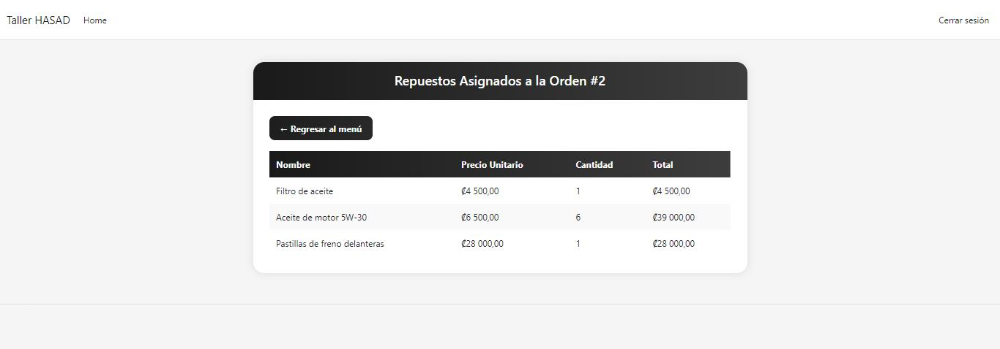
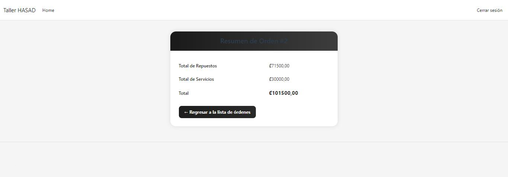
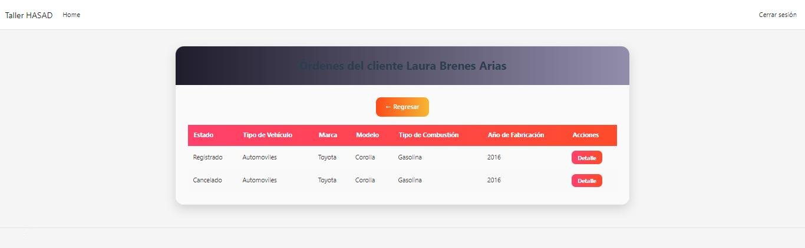

# Repair Order Management System

*[Leer en español](README.es.md)*

A web application for running an auto repair shop. It handles customers, mechanics, the parts and services inventory, and the full life cycle of a work order, from vehicle intake to the cost summary the customer sees.

Built as a team project for **IF4101 Business Application Languages** at the University of Costa Rica, Guanacaste campus (first semester 2025). The original version was deployed to Azure App Service with an Azure SQL database.



## Features

- **Three roles, each with its own views:** administrator, mechanic and customer.
- **Authentication:** passwords hashed with BCrypt, temporary account lockout after repeated failed attempts, email notification on every sign-in, and password change.
- **Customers and mechanics:** create, edit and search by name. New accounts get generated credentials sent by email.
- **Catalogs:** parts and services inventory with create, edit, detail and name filter.
- **Work orders:** create, edit, start and cancel (with a reason). Each order records vehicle type, fuel type, make, model and year.
- **Mechanic workflow:** assign parts and services to an order in progress, review what was assigned, view the cost summary and browse cancelled orders.
- **Customer view:** order status, the parts and services applied, and the cost summary.

## Screenshots

| | |
|---|---|
|  |  |
| Login | Administrator dashboard |
|  |  |
| Work orders | Assigning parts and services to an order |
|  |  |
| Cost summary | Customer view |

## Architecture

```
┌────────────────────┐   HTTP + X-API-KEY   ┌────────────────────┐
│  UI (ASP.NET MVC)  │ ───────────────────▶ │  SI (REST Web API) │
│  Razor + Bootstrap │                      │  Swagger           │
└────────────────────┘                      └─────────┬──────────┘
                                                      │
                                            ┌─────────▼──────────┐
                                            │  BL (business      │
                                            │  logic)            │
                                            └─────────┬──────────┘
                                                      │
                                            ┌─────────▼──────────┐      ┌──────────────┐
                                            │  DA (EF Core       │ ───▶ │  SQL Server  │
                                            │  DbContext)        │      │  / Azure SQL │
                                            └────────────────────┘      └──────────────┘
                 Model: entities, DTOs and ViewModels shared by every layer
```

| Project | Responsibility |
|---|---|
| `SistemaDeOrdenesDeReparacion.Model` | Entities, enums, DTOs and ViewModels |
| `SistemaDeOrdenesDeReparacion.DA` | Data access with Entity Framework Core |
| `SistemaDeOrdenesDeReparacion.BL` | Business rules, validation, password hashing and email |
| `SistemaDeOrdenesDeReparacion.SI` | REST API (integration services) protected by an API key |
| `SistemaDeOrdenesDeReparacion.UI` | MVC front end that consumes the API and manages the user session |

The first version called the business layer directly from MVC. In the second phase we migrated every module so the UI goes through the REST API.

## Tech stack

C# · .NET 8 · ASP.NET Core MVC · ASP.NET Core Web API · Entity Framework Core 8 · SQL Server / Azure SQL · BCrypt · Swagger · Bootstrap 5 · jQuery Validation · Azure App Service · Git

## Running locally

**Requirements:** .NET 8 SDK and SQL Server (LocalDB or SQL Server Express also work).

1. Create the database with the scripts in `database/`:
   ```bash
   sqlcmd -S localhost -E -f 65001 -i database/schema.sql
   sqlcmd -S localhost -E -f 65001 -i database/seed.sql
   ```
   The first script creates the `SistemaDeOrdenesDeReparacion` database and its tables. The second loads made-up sample data: customers, mechanics, parts, services and orders in every state.
2. Copy the configuration templates and fill in your values:
   - `SistemaDeOrdenesDeReparacion.SI/appsettings.Development.example.json` → `appsettings.Development.json`
   - `SistemaDeOrdenesDeReparacion.UI/appsettings.UI.Development.example.json` → `appsettings.UI.Development.json`

   Use the same `ApiKey` in both. Email is optional: if SMTP is not configured, sign-in still works and notification errors are only logged. These files are in `.gitignore`, so they are never committed.
3. Run both projects (in Visual Studio: *Configure Startup Projects → Multiple*, SI and UI):
   ```bash
   dotnet run --project SistemaDeOrdenesDeReparacion.SI --launch-profile https
   dotnet run --project SistemaDeOrdenesDeReparacion.UI --launch-profile https
   ```
   The API runs at `https://localhost:7102` (Swagger at `/swagger`) and the UI at `https://localhost:7214`.

### Test accounts

| Role | Username | Password |
|---|---|---|
| Administrator | `admin` | `Admin2025!` |
| Mechanic | `CarlosMoraVargas` | `Demo2025!` |
| Customer | `LauraBrenesArias` | `Demo2025!` |

## Team

Team project by six students:

- Aarón Salazar Mata
- Sebastián Apu Guillén
- Harold Barquero
- Martín [last name]
- [name] (Dann233)
- **Deiby [last name]**

### My contribution

- **Mechanic work module.** I built `TrabajoMecanicoController` and its 15 views, which the team later wired to the API: assigning parts and services to orders in progress, reviewing assignments, cost summaries for mechanics and customers, and the list and detail of cancelled orders. I also added the order–part and order–service join entities and their logic in `GestionDeOrdenesDeTrabajo`.
- **Services catalog, end to end:** the `InventarioDeServicios` model, `CatalogoDeServicios` in the business layer, `ServiciosController`, and the list, filter, create, edit and detail views.
- **REST API migration** for the parts and services modules: I created `ServicioDeRepuestosController` and `ServicioDeServiciosController` in the Web API and updated the MVC controllers to consume them through `HttpClient` with the API key.
- UI improvements to the administrator view and to the mechanic and customer dashboards.

## What I improved after the course

This portfolio copy starts from the original course repository. Since then I:

- **Removed hard-coded secrets.** The connection string, API key and SMTP account now come from configuration, and email sending lives in a single `ServicioDeCorreo` service.
- **Hashed passwords with BCrypt** (`SeguridadDeContrasenas`). Legacy plain-text passwords are upgraded to a hash the next time the user signs in.
- **Made notification emails non-blocking.** If sending fails, the error is logged and sign-in continues.
- **Added database scripts** (`database/schema.sql` and `database/seed.sql`) so the project can run from scratch.
- Fixed the UI configuration loading so environment-specific settings are applied, and removed the Azure publish profiles.

**Next steps:** EF Core migrations and unit tests.
